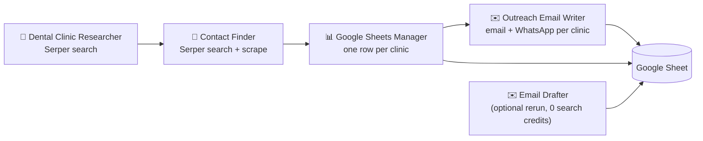

# Dental Clinic Outreach – CrewAI


AI agents that find dental clinics in a city, collect their **public** business contacts,
save them to **Google Sheets**, and draft a personalized **email + WhatsApp message**
for each clinic introducing Zero Company's services:

- WhatsApp AI agent (24/7 answers and appointment booking)
- AI voice / call center agent
- Website building
- Mobile app development

Built with [CrewAI](https://crewai.com) Studio, Serper (Google Search) and Google Sheets.

## How it works



## Results (first run, Amman)

| Clinics found | With mobile / WhatsApp | With email | Messages drafted |
|---|---|---|---|
| 40 | 20 | 13 | 40 |

## Agents (5 in total)

### 1. `lead-finder/`: main crew (4 agents, run in order)

| # | Agent | What it does | Tools |
|---|-------|--------------|-------|
| 1 | Dental Clinic Researcher | Searches English + Arabic and area by area (Abdoun, Khalda, Sweifieh, ...) | Serper search |
| 2 | Contact Finder | Finds public mobile/WhatsApp and email, records the source URL, never guesses | Serper search + scrape |
| 3 | Google Sheets Manager | Creates the sheet and writes one row per clinic, no duplicates | Google Sheets |
| 4 | Outreach Email Writer | Writes "Dear [Clinic Name], ..." email + WhatsApp message into the row | Google Sheets |

Cost per full run for Amman: about **120 Serper credits**, ~40 clinics found.

### 2. `email-drafter/`: email-only crew (1 agent)

Re-writes the email subject, body, status and WhatsApp message for every row of an
**existing** sheet. It uses no web search, so it costs **0 Serper credits**.

## Sheet columns

| A | B | C | D | E | F | G | H | I | J |
|---|---|---|---|---|---|---|---|---|---|
| Clinic Name | Area | Mobile/WhatsApp | Email | Website | Source URL | Email Subject | Email Body | Status | WhatsApp Message |

## How to run

**Easiest:** open the project in CrewAI Studio (app.crewai.com), click **Run**, and enter the inputs.

**Locally:**

```bash
pip install uv crewai
cd lead-finder            # or: cd email-drafter
cp ../.env.example .env   # then fill in your keys
crewai install
crewai run
```

Inputs:
- `lead-finder`: `CITY` (default Amman), `COUNTRY` (default Jordan), `SHEET_NAME`
- `email-drafter`: `SPREADSHEET_ID` (required), `TAB_NAME` (default `Sheet1`)

## Reuse for other cities or sectors

Change `CITY` (Irbid, Zarqa, Aqaba...) or edit the agents/tasks YAML in `config/` to target
other businesses (beauty clinics, physiotherapy centers, restaurants...).

## Responsible use

- Only public **business** contact details are collected, each with its source URL.
- Every message includes an opt-out line. Respect anyone who asks not to be contacted.
- Send in small batches (about 10–15 a day) and personally review messages before sending.
- **Never commit** `.env`, API keys, or the exported lead data (blocked by `.gitignore`).

## Author

**Aseel Gharaibeh**, AI automation & agents ([GitHub](https://github.com/Aseel-Gharaibeh12)).
See also: [CallCenterAi](https://github.com/Aseel-Gharaibeh12/CallCenterAi), an AI voice call center agent.

## License

[MIT](LICENSE)

---

## بالعربي

نظام من **5 وكلاء ذكاء اصطناعي** على CrewAI:

- **الفريق الرئيسي (`lead-finder`)، 4 وكلاء:**
  - يبحث عن عيادات الأسنان في المدينة.
  - يجمع أرقام الموبايل والإيميلات المنشورة للعامة.
  - يحفظها في Google Sheets.
  - يكتب لكل عيادة إيميل ورسالة واتساب باسمها، تعرّف بخدمات Zero Company: وكيل واتساب ذكي، وكيل كول سنتر صوتي، بناء مواقع، تطبيقات موبايل.
- **فريق الإيميلات (`email-drafter`)، وكيل واحد:** يعيد كتابة الإيميلات ورسائل الواتساب في شيت موجود، بدون استهلاك أي رصيد من Serper.

**ملاحظات مهمة:**
- لا ترفع ملف `.env` ولا مفاتيح الـ API ولا بيانات العيادات إلى GitHub.
- أرسل الرسائل على دفعات صغيرة، وراجعها قبل الإرسال.
